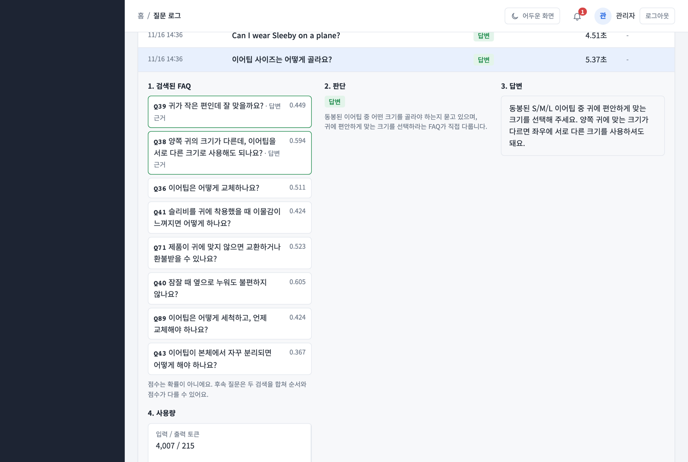
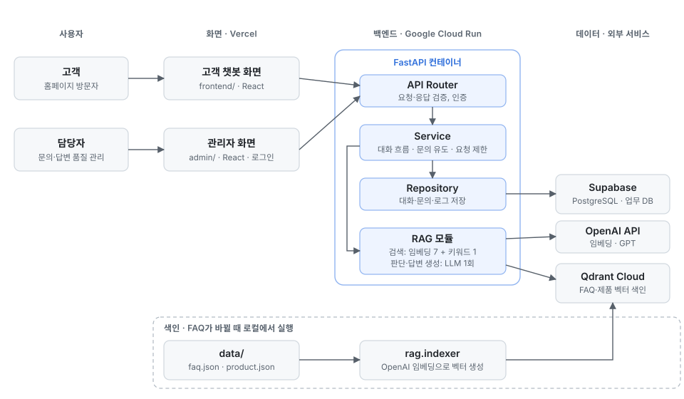

# 슬리비 AI 고객상담 챗봇

(주)슬리피의 디지털 귀마개 **슬리비(Sleeby)** 홈페이지에 들어가는 RAG 기반 고객상담 챗봇입니다.
FAQ와 제품 자료에서 찾은 내용으로만 답하고, 답하기 어려운 문의는 담당자 문의로 연결합니다.

| 고객 챗봇 | 관리자 화면 | API 명세 (Swagger) |
|---|---|---|
| https://sleeby-chat.vercel.app | https://sleeby-admin.vercel.app | https://sleepy-team.github.io/sleepy-chatbot/ |

## 데모 화면

> 표시된 문의와 수치는 예시 데이터이며 실제 고객 데이터가 아닙니다.

**홈페이지와 챗봇 위젯:** 분야를 고르거나 추천 질문을 눌러 바로 물어볼 수 있습니다.


**답변과 담당자 문의 접수 (모바일):** 답변 아래 "담당자에게 문의 남기기"를 누르고 이름·이메일·내용을 입력하면 접수 번호를 안내합니다. 문의에는 지금까지의 대화가 함께 전달됩니다.


| 관리자 대시보드 | 질문 로그 상세 (검색된 FAQ · 판단 · 답변) |
|---|---|
|  |  |

## 주요 기능

- **근거 기반 답변:** 검색된 FAQ·제품 정보에 적힌 내용으로만 답하고, 근거가 없으면 담당자 문의 카드를 띄웁니다.
- **응답 원칙:** 제품과 무관한 질문에는 답변 범위를 안내하고, 의학적 효과는 단정하지 않습니다. 고객이 쓴 언어로 답합니다.
- **관리자 화면:** 문의 관리, 질문 로그(검색 후보·근거·판단 사유), 답하지 못한 질문 묶음, 대시보드를 제공합니다.
- 출처와 판단 사유는 고객 응답에 넣지 않고 관리자 화면에서만 보여 줍니다.

## 사용 방법

1. 홈페이지 오른쪽 아래의 **안내 도우미** 버튼을 누르면 채팅창이 열립니다. 페이지의 질문 입력란이나 추천 질문을 눌러도 됩니다.
2. 슬리비에 대해 궁금한 점을 입력합니다. 이어서 묻는 질문은 직전 대화를 참고해 답합니다. (예: "충전은 얼마나 걸려요?" → "그럼 매일 해야 해요?")
3. 답변마다 👍/👎로 평가할 수 있고, 👎를 누르면 이유(틀렸어요 · 부족해요 · 질문과 무관해요)를 고를 수 있습니다.
4. 자료에 없는 내용이면 **담당자에게 문의 남기기** 버튼이 나옵니다. 채팅창 아래의 **담당자 문의**, **상담사 연결**로 언제든 문의할 수도 있습니다.

담당자는 [관리자 화면](https://sleeby-admin.vercel.app)에 로그인해 문의를 처리하고 질문 로그와 대시보드를 확인합니다.

## 시스템 구성



- 백엔드는 Router → Service → Repository 계층 구조입니다. RAG 모듈(`backend/rag/`)은 FastAPI에 의존하지 않아 설정 파일만으로 단독 실행·평가할 수 있습니다.
- 질문 하나에 LLM을 한 번 호출해, 답변할지 판단하는 일과 답변 생성을 함께 처리합니다. 채택 설정은 [`configs/rag/default.yaml`](configs/rag/default.yaml), 말투와 응답 규칙은 [`backend/rag/prompts/default.yaml`](backend/rag/prompts/default.yaml)에 있습니다.

| 영역 | 기술 |
|---|---|
| 프론트엔드 | React 19, Vite (JavaScript) |
| 백엔드 | FastAPI, SQLAlchemy(asyncio), Alembic, Python 3.11+ (`uv`) |
| RAG | LangChain, Qdrant, OpenAI `text-embedding-3-large` / `gpt-6-luna` |
| 업무 DB | PostgreSQL (운영 Supabase, 로컬 Docker) |
| 배포 | Google Cloud Run (`us-central1`), Vercel |

## 응답 성능

개발 평가 세트([`eval/dev_dataset.jsonl`](eval/dev_dataset.jsonl), 39문항)로 채택 설정을 3회 실행한 평균입니다 (2026-11-14).
세트는 오타, 잘못된 전제, 복합 질문, 프롬프트 주입처럼 약점을 찾기 위한 질문으로 구성했습니다. 유형별로는 답변 20, 부분 답변 5, 답변 불가 10, 범위 밖 4문항입니다.

| 지표 | 결과 | 의미 |
|---|---|---|
| 응답 유형 정확도 | **91.5%** (회차별 87–95%) | 답변·부분 답변·답변 불가·범위 밖 판단이 정답과 일치한 비율 |
| 근거 없는 답변 | **0%** | 답하면 안 되는 질문에 답한 비율 |
| 과잉 거절 | 8.3% | 답할 수 있는 질문을 거절한 비율 |
| 검색 적중률 | 96% | 정답 FAQ가 검색 후보 8개 안에 든 비율 |
| 응답 시간 | 평균 3.4초 · p95 6.6초 | 로컬에서 OpenAI를 호출해 측정 |
| 비용 | 질문 1,000건당 약 $0.51 | 질문당 평균 약 4,200토큰, 단가 입력 $0.1·출력 $0.5 (100만 토큰당) 가정 |

**답변 품질 점검 (2026-11-15):** 개발 세트 39문항과 위험·돌발 질문 18문항을 3번씩 물어 답변 171개를 점검했습니다. 근거 없는 답변은 0건이었고, 자료에 없거나 범위 밖인 질문 42번은 모두 답변을 보류했습니다. 자세한 결과와 남은 문제는 [답변 품질 평가 리포트](eval/%EC%8A%AC%EB%A6%AC%EB%B9%84%20FAQ%20AI%20%EC%B1%97%EB%B4%87%20%EB%8B%B5%EB%B3%80%20%ED%92%88%EC%A7%88%20%ED%8F%89%EA%B0%80%20%EB%A6%AC%ED%8F%AC%ED%8A%B8.md)에 있습니다.

모두 팀이 직접 만든 개발용 세트라 최종 평가 결과가 아닙니다. LLM 특성상 같은 질문이라도 실행마다 판단이 달라질 수 있습니다.

## 로컬 실행

필요한 것: Python 3.11+, [uv](https://docs.astral.sh/uv/), Node.js, Docker, OpenAI API 키.
저장소 루트에 [`.env.example`](.env.example)을 복사해 `.env`를 만들고 값을 채웁니다. `QDRANT_URL`을 비우면 로컬 Qdrant(`.qdrant/`)를 씁니다.

```bash
# 백엔드 (backend/)
uv sync
docker compose up -d                                              # 로컬 PostgreSQL
uv run alembic upgrade head
uv run python -m rag.indexer --config configs/rag/default.yaml   # 검색 색인 생성 (임베딩 비용 발생)
uv run uvicorn app.main:create_app --factory --reload             # http://localhost:8000/docs

# 고객 챗봇 (frontend/) → http://localhost:5173
npm install
npm run dev        # 백엔드 없이 화면만 보려면 npm run demo

# 관리자 화면 (admin/) → http://localhost:5175
npm install
npm run dev        # 가짜 데이터로 보려면 npm run mock
```

- 명령은 하나씩 실행합니다. Windows PowerShell 5.1에서는 `&&`가 동작하지 않습니다.
- 처음 한 번 이후에는 백엔드·챗봇·관리자 화면의 마지막 명령만 터미널 세 개에서 실행하면 됩니다. 색인은 FAQ 데이터나 임베딩 모델이 바뀔 때만 다시 만듭니다.

**막혔을 때 확인할 것**

| 증상 | 확인할 것 |
|---|---|
| 서버 시작 시 `IndexOutdatedError` | 색인이 없거나 데이터·임베딩 모델과 맞지 않습니다. 인덱서를 다시 실행합니다 |
| 서버 시작 시 OpenAI `403` | `configs/rag/default.yaml`의 모델을 OpenAI 프로젝트에서 쓸 수 있는지, 키의 권한을 확인합니다 |
| "서버와 연결하지 못했어요" 또는 CORS 오류 | 백엔드가 떠 있는지, `.env`의 `CORS_ORIGINS`에 화면 주소가 있는지 확인합니다. 바꿨다면 백엔드를 다시 시작합니다 |
| DB 연결 오류 | DB 컨테이너가 켜져 있는지 확인합니다. `DATABASE_URL`에는 `sslmode=` 대신 `ssl=`를 쓰고, 비밀번호의 특수문자는 URL 인코딩합니다 |
| 관리자 화면 "API 주소가 설정되지 않았어요" | 빌드에서는 `VITE_API_BASE_URL`을 지정해야 합니다 |

## 프로젝트 구조

```
├── frontend/      # 고객 챗봇 화면 (데모 홈페이지 포함)
├── admin/         # 관리자 화면
├── backend/
│   ├── app/       # FastAPI: api/ services/ repositories/ schemas/ core/ db/
│   ├── rag/       # RAG 모듈, prompts/ 시스템 프롬프트
│   ├── migrations/
│   └── tests/
├── configs/rag/   # RAG 설정 (채택: default.yaml)
├── data/          # FAQ·제품 정보 JSON (색인 대상)
└── eval/          # 개발용 평가 세트, 평가 스크립트, 품질 평가 리포트
```

## 배포

| 구성 | 서비스 |
|---|---|
| 백엔드 | Google Cloud Run (`us-central1`, 인스턴스 최대 1개) |
| 화면 | Vercel (`frontend/`, `admin/` 각각) |
| 업무 DB / 벡터 DB | Supabase PostgreSQL / Qdrant Cloud |

```bash
gcloud run deploy sleeby-backend --source . --region us-central1 --max-instances 1
```

- 컨테이너는 시작할 때 DB 마이그레이션을 적용합니다. 요청 제한과 로그인 잠금이 메모리에 있어서 인스턴스는 1개로 유지합니다.
- FAQ가 바뀌면 인덱서로 Qdrant Cloud 색인을 다시 만든 뒤 배포합니다.
- 프론트 주소가 바뀌면 백엔드 환경변수 `CORS_ORIGINS`에 추가합니다.

## 테스트

```bash
cd backend
uv run pytest      # 별도 DB(sleeby_test)를 비우고 시작하므로 운영 DB 주소를 넣지 않습니다
uv run ruff check .
```

프론트엔드(`frontend/`, `admin/`)는 `npm run lint`, `npm run build`로 확인합니다.

## 알려진 제약

- 구매처·가격처럼 기업이 아직 확정하지 않은 내용은 데이터에 넣지 않았고, 이런 질문은 담당자 문의로 안내합니다.
- 위기 표현(자해 암시, 응급 증상)에 대한 전용 안내가 아직 없습니다.
- 복합 질문에서는 자료에 있는 내용도 "확인된 안내가 없다"고 답할 수 있습니다.
- 답변 스트리밍·멈추기, 새로고침 후 대화 복원은 아직 구현하지 않았습니다.

## 팀

| 이름 | 역할 |
|---|---|
| 정하현 | 팀장 |
| 김선호 | 기술 리드, 백엔드 설계, 배포, 관리자 페이지 프론트엔드 개발 |
| 곽소영 | 리서치, 챗봇 프론트엔드 개발 |
| 박승환 | 발표, 챗봇 프론트엔드 개발 |

RAG와 백엔드 API는 네 명이 함께 구현했습니다.

## 협업과 자료 관리

- `main`에서 `type/작업내용` 브랜치를 만들고 Pull Request로 반영합니다. 커밋은 Conventional Commits 형식을 따릅니다.
- API 키와 `.env`, 기업 제공 원본 자료(`docs/`), 비공개 평가 질문은 저장소에 넣지 않습니다.
- 고객 IP는 원본 대신 해시로만 저장하고, 실제 고객 데이터는 쓰지 않습니다.
